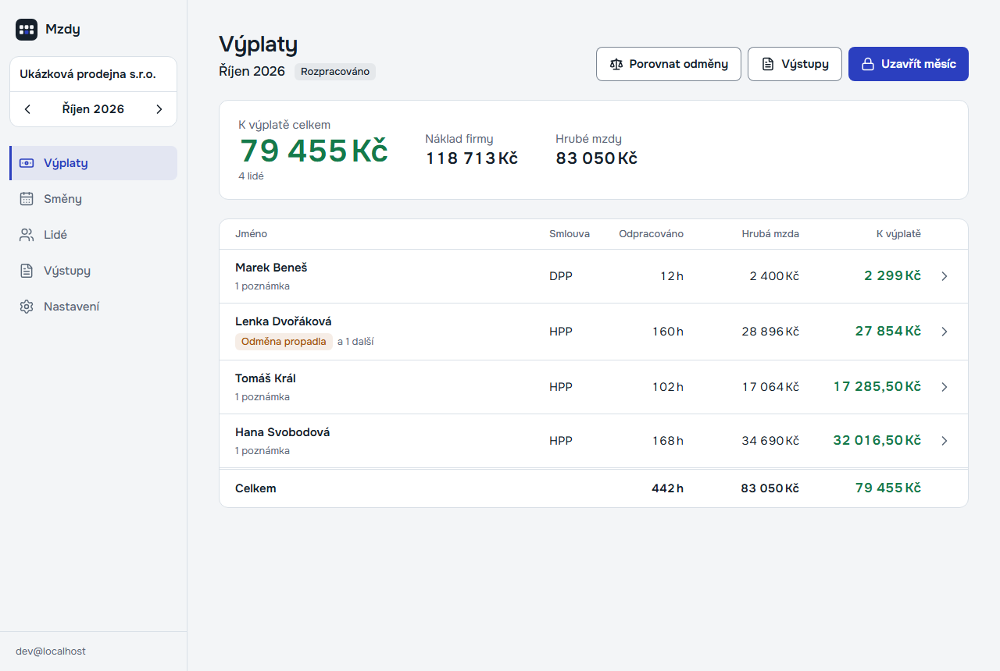
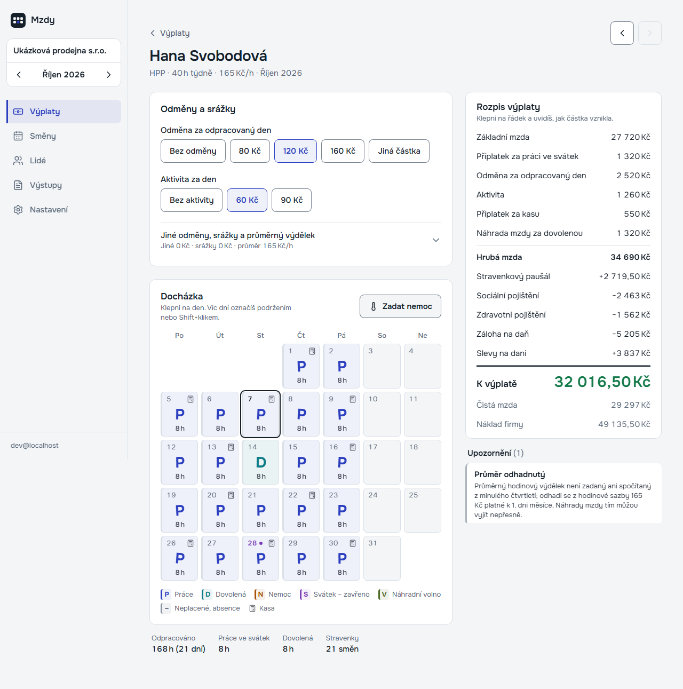
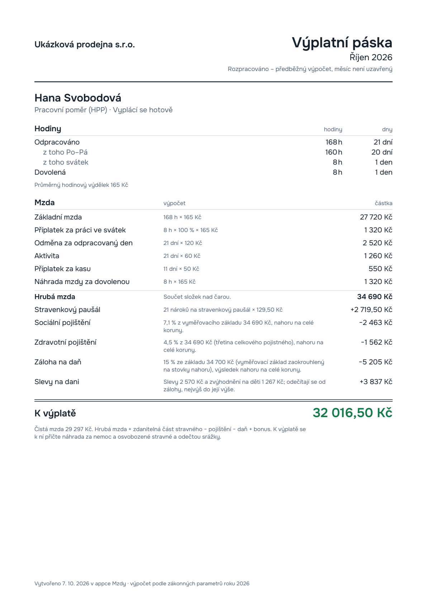
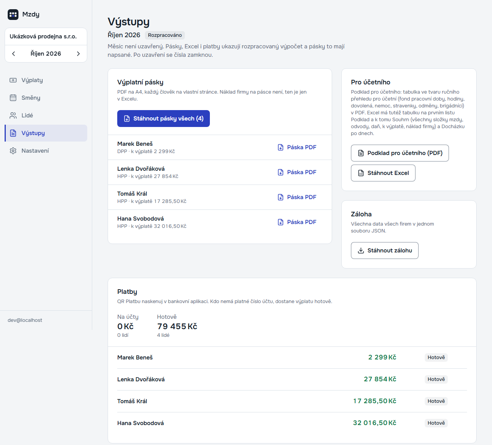
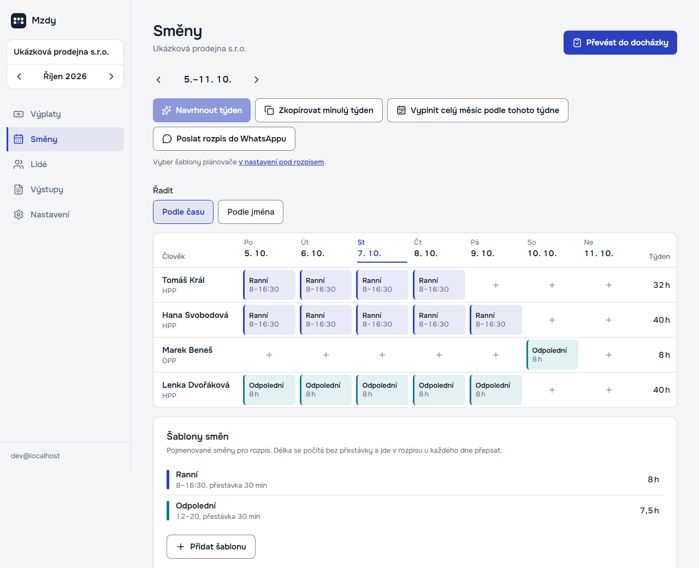
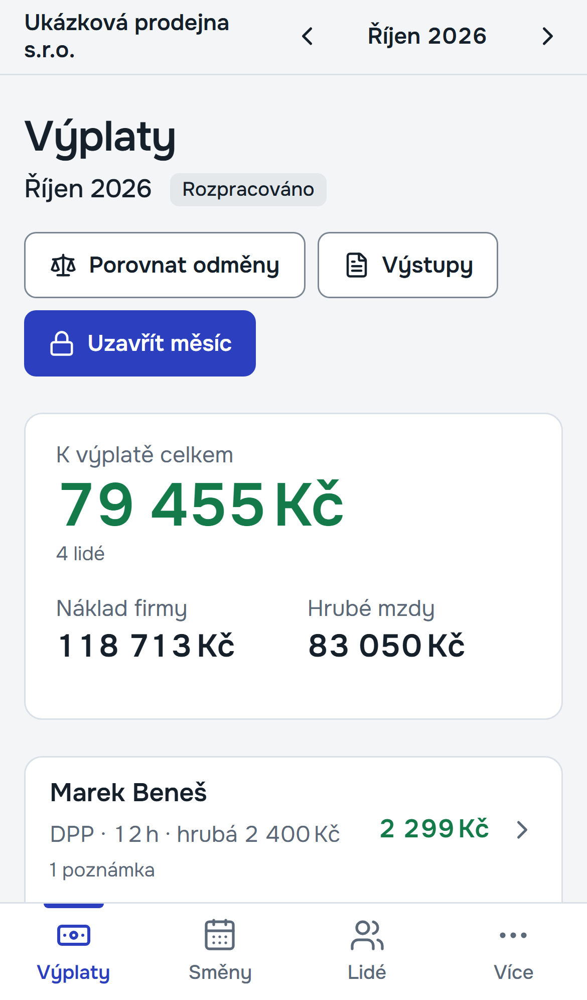
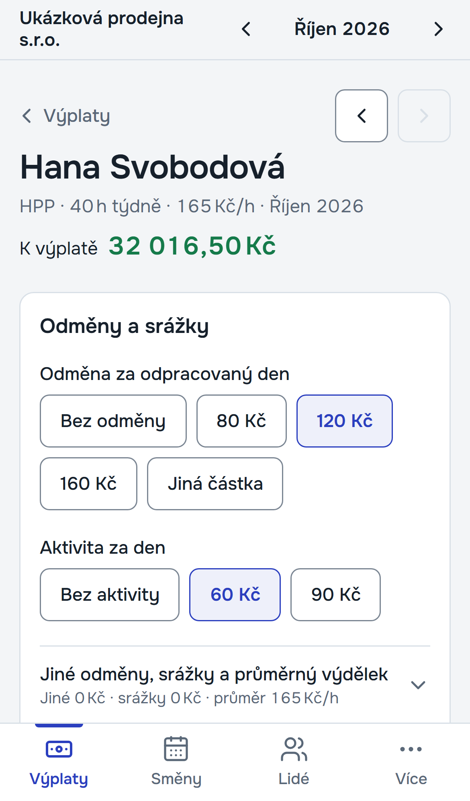
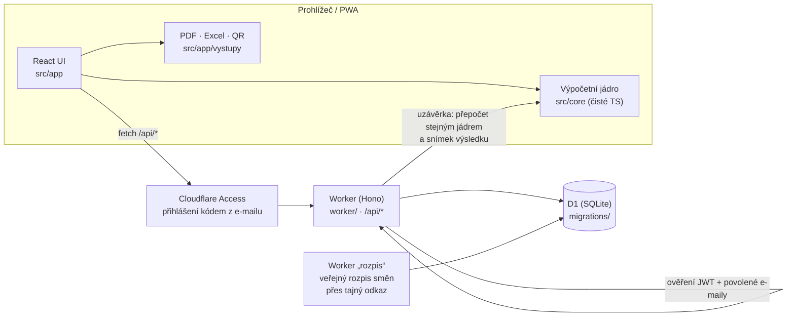

# Mzdy a plánovač směn · Payroll & Shift Planner

**Česky** · [English below](#english)



## Pro majitele malých firem

**Problém.** Ve firmě s pár zaměstnanci se výplaty každý měsíc počítají v Excelu. Pak se to celé přepisuje
do podkladů pro účetní a směny se domlouvají přes WhatsApp. Stačí jeden překlep v sazbě nebo zapomenutý
svátek a člověk dostane špatnou výplatu. Na chybu se navíc přijde až u účetní.

**Řešení.** Jedna webová aplikace pro počítač i telefon. Zadáte docházku (stačí ťukat do kalendáře)
a měsíční odměny. Appka sama spočítá hrubou mzdu, pojištění, zálohu na daň, slevy, čistou mzdu, částku
k výplatě i celkový náklad firmy, a to podle českých předpisů pro daný rok. U každé částky ukáže,
jak vznikla.

**Přínos.**
- Výplata je hotová za pár minut, ne za odpoledne. Vidíte ji průběžně během měsíce, ne až na konci.
- Výplatní pásky v PDF pro každého, podklad pro účetní (PDF a Excel) a QR platby pro bankovní appku.
- Rozpis směn na týden: navrhne ho plánovač, hlídá, aby byla obsazená kasa, a rozpis jde jedním
  kliknutím poslat do WhatsAppu nebo na tablet v prodejně.
- Uzávěrka měsíce čísla zamkne, takže je později nikdo omylem nezmění.

Appka je nasazená v reálném provozu v maloobchodu s pracovními oděvy (2 firmy). Počítají se v ní
výplaty a plánují směny.

## Co umí

| Oblast | Funkce |
|---|---|
| **Mzdy podle českých předpisů** | HPP s hodinovou sazbou a DPP. Sociální a zdravotní pojištění včetně minimálního vyměřovacího základu, záloha na daň a srážková daň, slevy na dani a daňové zvýhodnění na děti, invalidita a ZTP/P. Dále sleva na pojistném, příplatky za svátek, náhrada mzdy za nemoc s redukčními hranicemi, dovolená v hodinách, průměrný výdělek a stravenkový paušál. Parametry pro roky 2026 a 2027 jsou oddělené (`src/core/parametry/`) |
| **Výplatní pásky (PDF)** | stránka A4 pro každého člověka nebo všechny najednou. U každé částky je vzorec, ze kterého vznikla |
| **Podklady pro účetní** | PDF ve tvaru, na jaký je účetní zvyklá, a Excel (podklad, souhrn složek mzdy, docházka po dnech) |
| **QR platby** | čísla účtu se převedou na IBAN s kontrolou modulo 11 a vznikne QR kód SPAYD pro bankovní aplikaci |
| **Plánovač směn** | šablony směn, týdenní rozpis, návrh týdne podle pravidel obsazení (kasa, otevírací doba) a převod plánu do docházky. Rozpis jde poslat do WhatsAppu a lidé mají tajné odkazy na veřejný rozpis bez přihlášení |
| **Uzávěrka a přehledy** | uzavřený měsíc se uloží jako snímek, k tomu přehled nákladů firmy za rok, porovnání variant odměn a záloha všech dat do JSON |
| **PWA** | instaluje se na telefon jako aplikace. Na mobilu má spodní lištu a na PC boční panel |

| | |
|---|---|
|  |  |
| Detail člověka: docházka v kalendáři a rozpis výplaty | Výplatní páska (PDF) |
|  |  |
| Výstupy: pásky, podklady pro účetní, platby, náklady | Plánovač směn: týdenní rozpis a šablony |
|  |  |
| Mobil: výplaty | Mobil: odměny člověka |

Všechny snímky jsou z vestavěné ukázkové firmy „Ukázková prodejna s.r.o.“ se čtyřmi smyšlenými lidmi.

## Technická část

### Stack

- **Frontend:** React 19, React Router, TanStack Query, Tailwind CSS 4, Vite 8, vite-plugin-pwa
- **Backend:** Cloudflare Workers + Hono, databáze Cloudflare D1 (SQLite) přes Drizzle ORM, validace Zod
- **Přihlášení:** Cloudflare Access. Worker sám ověřuje JWT (jose, RS256, issuer, audience) a seznam
  povolených e-mailů. Bez nastavení je API zamčené (fail-closed)
- **Výstupy:** pdf-lib (pásky a podklady s vloženým písmem Onest), ExcelJS, qrcode (SPAYD)
- **Testy:** Vitest (jádro, Worker nad Miniflare D1, UI v jsdom s Testing Library), Playwright (e2e)
- **Jazyk:** TypeScript ve strict režimu. Názvy v kódu jsou česky, stejně jako doména (mzda, docházka, směna)

### Architektura



- **`src/core/`** je výpočetní jádro bez Reactu, DOM i Node: peníze v haléřích, hodiny v minutách,
  parametry jednotlivých let, kalendář a svátky, pojistné, daň, nemoc, dovolená, plánovač směn a IBAN/SPAYD.
  Stejný kód běží v prohlížeči (okamžitý výpočet) i ve Workeru (uzávěrka).
- **`src/app/`**: React UI, API klient, výstupy PDF a Excel.
- **`worker/`**: REST API, ověření přístupu, CSRF ochrana, bezpečnostní hlavičky, zápisy po dávkách
  (limit D1 je 50 příkazů na požadavek) a vestavěná ukázková firma (`worker/demo.ts`).
- **`rozpis/`**: samostatný malý Worker, který ukazuje rozpis směn přes tajný odkaz (tablet v prodejně,
  telefon zaměstnance) bez přihlášení a bez citlivých údajů.
- **`docs/research/`**: rešerše zákonných parametrů 2026/2027 s odkazy na paragrafy.

### Spuštění lokálně s ukázkovou firmou

Potřebujete Node.js 22 nebo novější. Všechno běží lokálně (Miniflare), účet u Cloudflare není potřeba.

```bash
npm install
cp .dev.vars.example .dev.vars   # DEV_BYPASS=1: lokální obejití přihlášení (platí jen na localhostu)
npm run db:migrate:local         # vytvoří lokální D1 ve složce .wrangler/
npm run dev                      # http://localhost:5173
```

Na první obrazovce klikněte na **„Vyzkoušet na ukázkových datech“**. Vznikne „Ukázková prodejna s.r.o.“
se čtyřmi smyšlenými lidmi, docházkou a odměnami na aktuální měsíc. Smazat ji jde v Nastavení.

### Testy

```bash
npm test            # Vitest: 73 souborů, 814 testů (jádro, Worker nad Miniflare D1, UI)
npm run typecheck   # tsc pro app, worker i node konfiguraci
npm run e2e         # Playwright průchod postavenou appkou (PC i iPhone 14); poprvé: npx playwright install chromium
```

Každé mzdové pravidlo má v jádru test s ručně spočtenou hodnotou.

### Nasazení

`wrangler.jsonc` obsahuje zástupné hodnoty. Pro vlastní nasazení je potřeba založit D1
(`wrangler d1 create mzdy`), doplnit `database_id` a `ALLOWED_EMAILS` a zapnout Cloudflare Access.
Potom uložit secrets `ACCESS_AUD` a `ACCESS_TEAM_DOMAIN`. Adresa veřejného rozpisu je v `src/shared/api.ts`
(`ADRESA_ROZPISU`). Nasazovací skript ostré instance v této ukázkové verzi není.

## Kontakt

**Jaroslav Velek** · [jaravelin@gmail.com](mailto:jaravelin@gmail.com)

Podobnou aplikaci nebo automatizaci pro vaši firmu rád probereme.

---

<a id="english"></a>

# English

## For small business owners

**The problem.** In a company with a handful of employees, payroll is done in a spreadsheet every month.
Then it gets retyped into paperwork for the accountant, and shifts get arranged over WhatsApp. One typo
in an hourly rate or a forgotten public holiday means someone is paid the wrong amount. And the mistake
only surfaces at the accountant.

**The solution.** One web app for desktop and phone. You enter attendance (tap days in a calendar) and
monthly bonuses. The app calculates gross pay, social and health insurance, income-tax advance, tax
credits, net pay, the amount to pay out and the total cost to the company. It follows Czech payroll law
for the given year and shows how every single amount was calculated.

**What you get.**
- Payroll takes minutes, not an afternoon, and you can see it during the month, not just at the end.
- PDF payslips for everyone, a summary for the accountant (PDF and Excel) and QR payment codes for
  the banking app.
- A weekly shift schedule: the planner proposes it and keeps the till staffed. The schedule goes to
  WhatsApp or to a tablet in the shop in one click.
- Closing the month locks the numbers, so nobody changes them by accident later.

The app runs in real production in workwear retail (2 companies), where it is used for payroll and
shift planning.

## Features

| Area | What it does |
|---|---|
| **Czech payroll rules** | Hourly-paid employment contracts and short-term agreements (HPP/DPP). Social and health insurance incl. the minimum assessment base, income-tax advance and withholding tax, tax credits and child benefit, disability, insurance discounts, holiday pay premiums, sick pay with reduction thresholds, leave in hours, average earnings and meal allowance. Parameters are separated per year (2026, 2027) |
| **PDF payslips** | one A4 page per person or all at once, with the formula behind every amount |
| **Accountant export** | PDF in the format accountants expect and Excel (summary, pay components, daily attendance) |
| **QR payments** | Czech account number → IBAN (mod-11 validation) → SPAYD QR code |
| **Shift planner** | shift templates, weekly schedule, auto-proposal based on staffing rules, schedule → attendance. Schedule can be shared to WhatsApp, and staff get secret read-only links |
| **Month close & reports** | snapshot of the closed month, yearly cost overview, comparison of bonus variants, JSON backup |
| **PWA** | installable on phones, bottom bar on mobile and sidebar on desktop |

Screenshots above come from the built-in demo company with four fictional people.

## Technical overview

- **Stack:** React 19, TanStack Query, Tailwind CSS 4, Vite 8, PWA · Cloudflare Workers + Hono, D1 (SQLite)
  via Drizzle ORM, Zod · Cloudflare Access with JWT verification in the Worker (fail-closed) · pdf-lib,
  ExcelJS, qrcode · Vitest + Playwright · strict TypeScript (identifiers are in Czech, matching the domain).
- **Architecture:** see the Mermaid diagram above. The pure-TypeScript calculation core (`src/core/`) runs
  both in the browser (instant results) and in the Worker (month close snapshot). A second small Worker
  (`rozpis/`) serves the public shift schedule via secret links.

### Run locally with the demo company

```bash
npm install
cp .dev.vars.example .dev.vars   # DEV_BYPASS=1, local-only auth bypass (honoured on localhost only)
npm run db:migrate:local
npm run dev                      # http://localhost:5173
```

Click **„Vyzkoušet na ukázkových datech“** ("Try with demo data") on the first screen.

### Tests

```bash
npm test            # Vitest: 73 files, 814 tests
npm run typecheck
npm run e2e         # Playwright, desktop + iPhone 14
```

## Contact

**Jaroslav Velek** · [jaravelin@gmail.com](mailto:jaravelin@gmail.com)

## License

All rights reserved. The source is published for review only, see [LICENSE](LICENSE).
